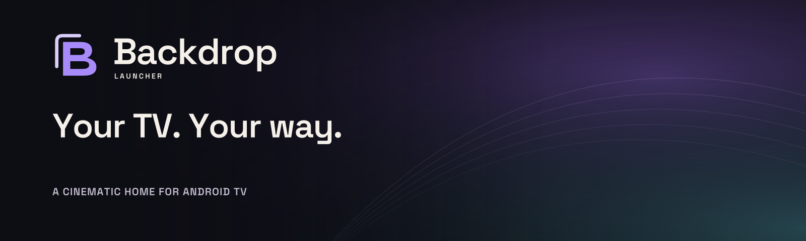
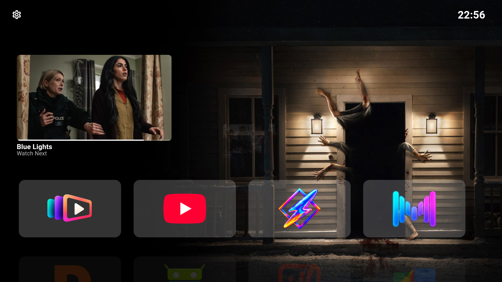
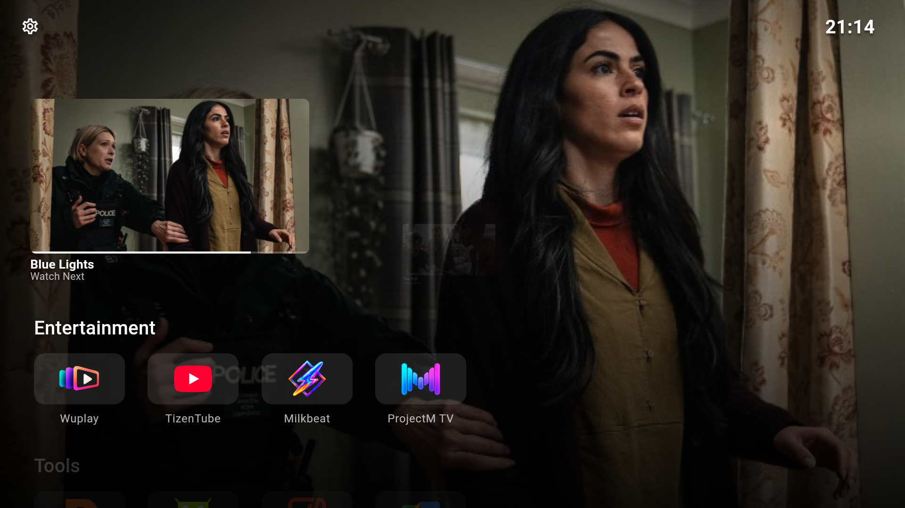
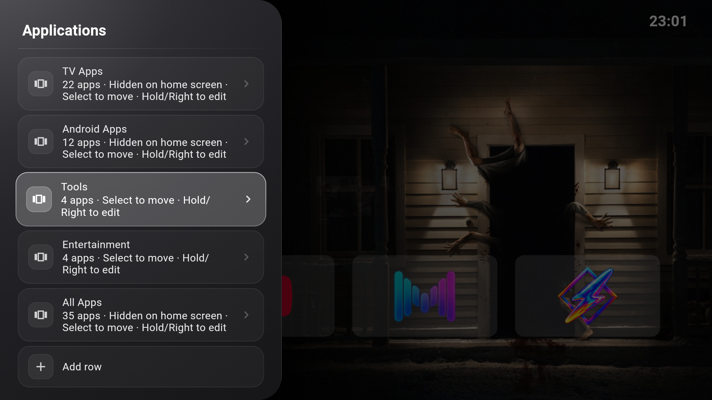
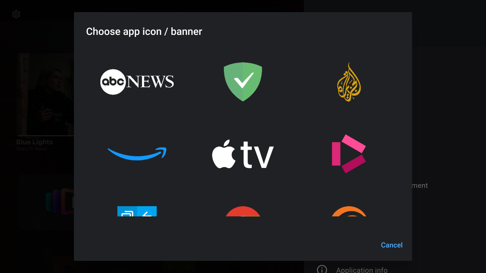
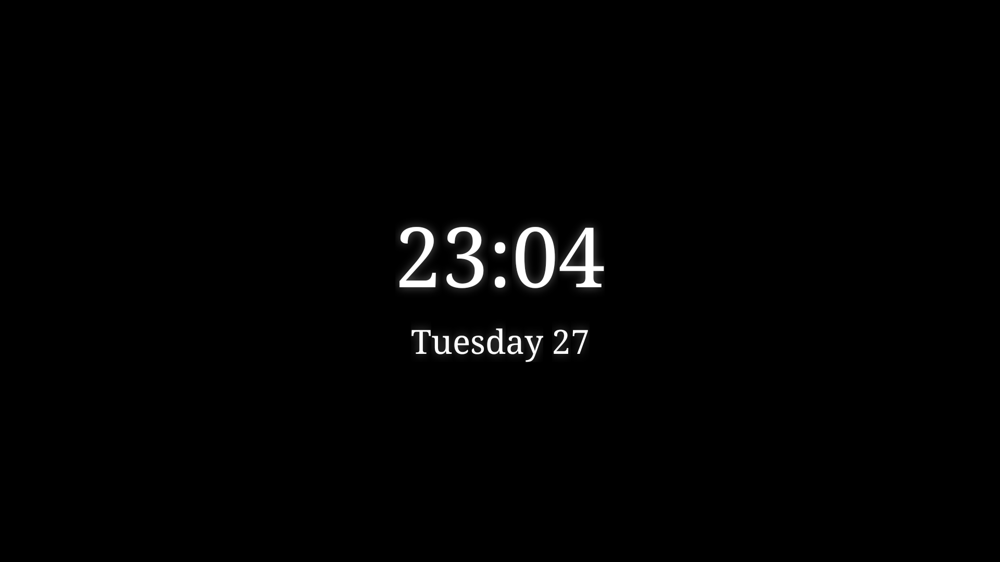

<picture>
  <source media="(prefers-color-scheme: dark)" srcset="docs/assets/brand/readme-dark.png">
  <source media="(prefers-color-scheme: light)" srcset="docs/assets/brand/readme-light.png">
  
</picture>

<p align="center">
  <a href="https://github.com/johnneerdael/Backdrop-Launcher/releases/latest"></a>
  <a href="https://github.com/johnneerdael/Backdrop-Launcher/actions/workflows/checks.yml"></a>
  <a href="https://backdrop-launcher.neerdael.nl/"></a>
  <a href="LICENSE"></a>
</p>

**A cinematic home for Android TV.** Backdrop Launcher keeps your apps within easy reach and lets your artwork fill the screen. Arrange your own rows, pick up with Continue Watching and make the details yours.

<p align="center">
  <a href="https://github.com/johnneerdael/Backdrop-Launcher/releases/latest/download/backdrop-launcher.apk"><strong>Download APK</strong></a> ·
  <a href="https://backdrop-launcher.neerdael.nl/get-started/install/">Install</a> ·
  <a href="https://backdrop-launcher.neerdael.nl/">User guide</a> ·
  <a href="https://github.com/johnneerdael/Backdrop-Launcher/releases">Release notes</a>
</p>



## Your home, arranged your way

| Capability | What you can do |
| --- | --- |
| **Apps and rows** | Create, reorder, rename and hide rows. Choose their apps and size; hide individual apps globally. |
| **Continue Watching** | Resume programmes shared by compatible TV apps, with playback progress and a spacious two-item carousel. |
| **Cinematic backdrops** | Enjoy ten included offline images, or connect Trakt for trending and anticipated movies/shows and popular public lists. |
| **Personal touches** | Pick app artwork, your accent colour, focus outlines, labels and accent-coloured tile backgrounds with opacity in 10% steps. |
| **A quieter screen** | Customize the date, time and status icons, and choose a moving clock screensaver. |
| **Ready when you return** | Restore cached app artwork, the last wallpaper and Continue Watching at startup. No added branding splash or deliberate wait. |
| **Straightforward updates** | The GitHub build checks this repository for signed releases and can hand the APK to Android’s installer. |

<table>
<tr>
<td width="50%"><br><strong>Pick up where you left off</strong></td>
<td width="50%"><br><strong>Make room for your apps</strong></td>
</tr>
<tr>
<td><br><strong>Choose your app artwork</strong></td>
<td><br><strong>Let the screen breathe</strong></td>
</tr>
</table>

The screenshots above illustrate the earlier Flutter release. The native interface retains these workflows; its implementation and current validation are described in [Kotlin/Compose validation](docs/development/compose-production-validation.md).

The [illustrated user guide](https://backdrop-launcher.neerdael.nl/) walks through every settings page, remote controls, app management, backdrops, clocks and troubleshooting. The [ten-image screenshot pack](marketing/README.md) includes captions and capture provenance.

## Get started

1. Download [`backdrop-launcher.apk`](https://github.com/johnneerdael/Backdrop-Launcher/releases/latest/download/backdrop-launcher.apk) on your Android TV, or transfer it from another device.
2. Allow installation from the app you used to open the APK, then install it.
3. Press Home and choose **Backdrop Launcher** as your home app. Your firmware may offer this choice in its default-app settings.

See [installation and default-home setup](https://backdrop-launcher.neerdael.nl/get-started/install/) for detailed steps and ADB instructions. Backdrop Launcher uses **`nl.neerdael.backdrop_launcher`** and installs separately from earlier Media Launcher test builds.

On Home, **tap Center/Select to open an app** or **hold it to open its actions**. Up/Down switches rows; a faint next-row preview keeps the backdrop visible. In **Settings → Applications**, select a row to move it with Up/Down, then select again to finish. Hold Select or press Right to edit its contents and properties.

Continue Watching depends on your TV’s public Watch Next provider and apps that publish resume items; it has been tested with WuPlay. Some firmware needs an additional TV-listings permission. Trakt is an optional **backdrop source**, with device-code approval on your phone; it does not synchronize viewing history or provide streaming access.

## Build and contribute

The production launcher uses **Kotlin and Jetpack Compose for TV**, Android SDK API **36**, and Java **17 or 21**. Build and test instructions, local API configuration and release signing are documented in [Building Backdrop Launcher](docs/development/building.md) and [Release automation](docs/development/releases.md).

```sh
cd native-launcher
./gradlew :app:testGithubReleaseUnitTest :app:lintGithubRelease :app:assembleGithubRelease
```

The native build retains the production application ID, signing identity and existing launcher data. Historical Dart sources remain as migration references; production APKs contain no Flutter engine. Source copyright notices and the GPL remain intact.

## Credits and licence

Backdrop Launcher is maintained by **John Neerdael**, building on [Arc Launcher](https://github.com/meddouribadis/arclauncher) by Badis Meddouri, [LTvLauncher](https://github.com/LeanBitLab/LtvLauncher) by LeanBitLab and [FLauncher](https://gitlab.com/flauncher/flauncher) by Étienne Fesser and its contributors.

Media metadata and online backdrops come from [TMDB](https://www.themoviedb.org/). This product uses the TMDB API but is not endorsed or certified by TMDB. [Trakt](https://trakt.tv/) supplies optional catalogue selections. Third-party app logos and programme artwork remain the property of their respective owners.

Released under the [GNU GPL v3 or later](LICENSE). See [credits and bundled font licences](CREDITS.md).
