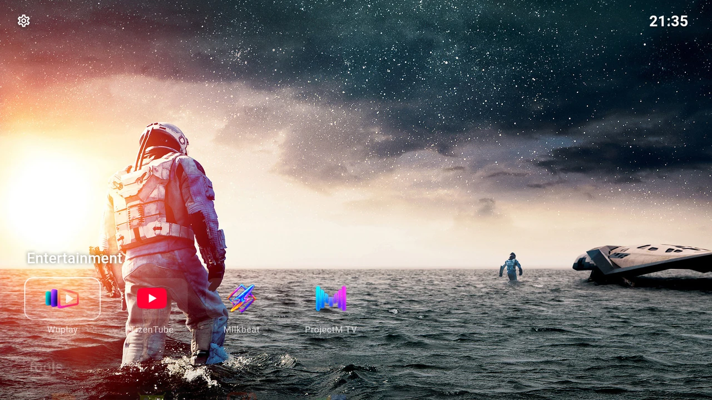

# Get started

Start with a working Android TV remote and a Backdrop Launcher APK. You can use the included artwork immediately; a Trakt account is optional.

1. **[Install Backdrop Launcher](install.md).** Open the downloaded APK on your TV and follow Android’s installer.
2. **[Find your way around](remote.md).** Use the D-pad, Select and Back to reach apps and Settings.
3. **[Build your first row](../home/rows.md#create-a-row).** Give it a name and select the apps you want in it.
4. **[Choose the view](../personalise/appearance.md).** Pick an accent and card background that work with your backdrop.
5. **[Turn on Continue Watching](../home/continue-watching.md#turn-it-on).** Compatible apps can then contribute programmes to Home.

{ width="1280" height="720" loading="lazy" }

The guide uses English menu labels. Translated labels and Android’s own settings may differ on your TV. Screenshots show real TV captures; the selected apps, artwork, time and saved preferences are examples.
