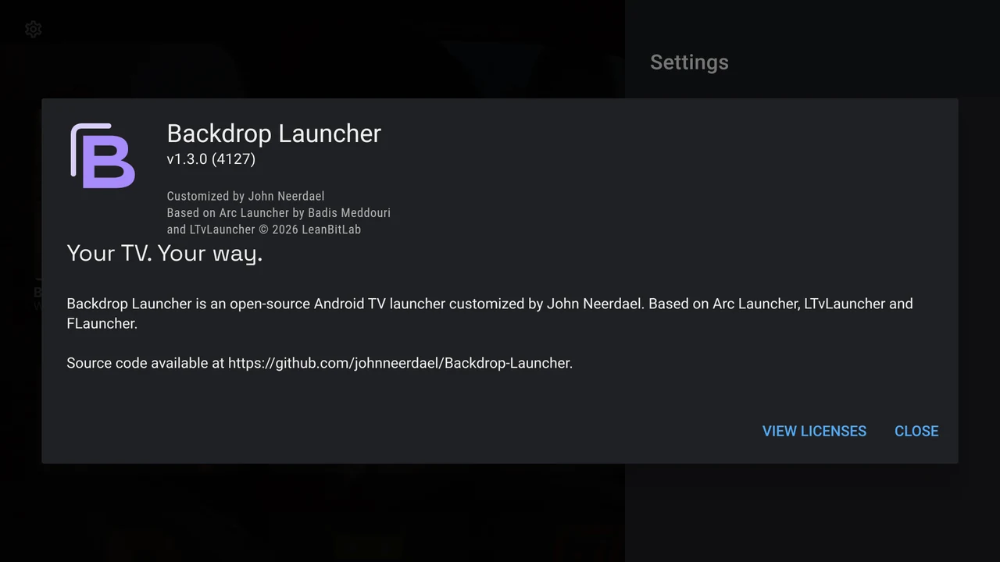

# Credits and licences

Backdrop Launcher is customised by **John Neerdael** and builds on the work of these projects and their contributors:

- [Arc Launcher](https://github.com/meddouribadis/arclauncher) by Badis Meddouri.
- [LTvLauncher](https://github.com/LeanBitLab/LtvLauncher) by LeanBitLab.
- [FLauncher](https://gitlab.com/flauncher/flauncher) by Étienne Fesser and the community.

Trakt authentication and backdrop behaviour were adapted from the author’s `traktlistbackdrops` work. Existing source copyright notices are preserved.

## Free software

Backdrop Launcher is distributed under the **GNU General Public License, version 3 or later**, without warranty. Read the [complete project licence](https://github.com/johnneerdael/Backdrop-Launcher/blob/main/LICENSE) and [source code](https://github.com/johnneerdael/Backdrop-Launcher).

For the libraries included in your installed build, open **Settings → About Backdrop Launcher → View licenses**. Choose a package to read its notices. The exact package list depends on the build.

{ loading=lazy }

## Backdrop services and third-party artwork

Movie and television metadata and backdrops are provided by [TMDB](https://www.themoviedb.org/). **This product uses the TMDB API but is not endorsed or certified by TMDB.**

[Trakt](https://trakt.tv/) supplies selected catalogs and public lists for backdrop discovery. Backdrop Launcher is independent of Trakt. Neither service connection supplies streaming access or implies a partnership.

Screenshots retain the app logos, programme names and artwork shown on the TV. These belong to their respective owners; inclusion illustrates launcher behaviour and does not imply endorsement.

## Website identity and fonts

The guide follows the **Backdrop Launcher** identity: twilight violet, afterglow, mist, night and warm white, with accessible light-theme counterparts. The custom mark keeps its two screen-shaped openings and separate rear frame.

Typography is served locally using **Space Grotesk** for headings, **Inter** for body text and **IBM Plex Mono** for technical text. The website makes no external font requests. Each is redistributed under its supplied SIL Open Font License notice:

- [Space Grotesk licence](../assets/fonts/SpaceGrotesk-OFL.txt)
- [Inter licence](../assets/fonts/Inter-OFL.txt)
- [IBM Plex Mono licence](../assets/fonts/IBMPlexMono-OFL.txt)

The site is built with [MkDocs](https://www.mkdocs.org/) and [Material for MkDocs](https://squidfunk.github.io/mkdocs-material/). Its documentation source lives with the [project on GitHub](https://github.com/johnneerdael/Backdrop-Launcher/tree/main/docs/user-guide).
