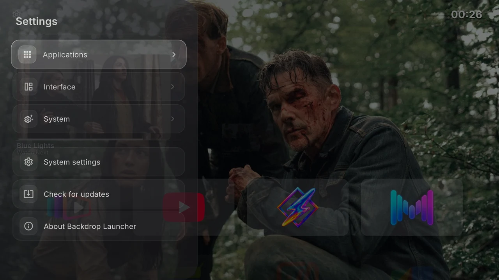
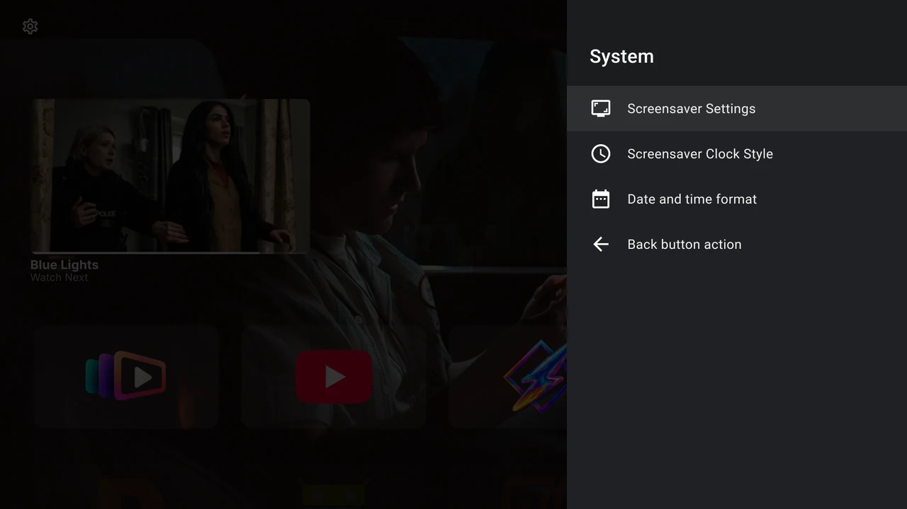

# Settings reference

{ loading=lazy }

Open Settings by moving Up to the gear beside the clock at the top right of Home and pressing Select. Options save as you change them. This page lists the current English controls; saved preferences on your TV may differ from new-install defaults.

Settings opens as a compact pane on the right, with the typography, charcoal surfaces and blue controls of native Android TV settings. Press **Back** to return to the previous page, then again to close the pane. Opening **System settings** closes the launcher pane before Android's settings appears.

## Applications

| Control | Choices or action |
| --- | --- |
| Existing row | **Select** to move; **Right / hold Select** to edit. |
| **Add row** | Name and create a row. |
| **Installed apps** | View TV and Android apps, including hidden apps. Open an app for its details. |

In the row editor:

| Control | Choices or action |
| --- | --- |
| **Row name** | Rename, Save or Cancel. |
| **App order** | **Manual**, **Alphabetical**, **Last used**. New row: Manual. |
| **Row size** | **82**, **110**, **140**. New row: 110. Actual card height is constrained by the layout. |
| **Show on home screen** | Show/hide the row. New row: on. Empty rows stay absent from Home. |
| **Delete row** | Delete immediately, without confirmation. Apps stay installed. |
| **TV apps / Android apps** | Check membership in this row. |

See [Rows](../home/rows.md) and [Apps and artwork](../home/apps.md) for the corresponding tasks and the Home app action menu.

## Interface → Watch Next

| Control | Choices or action |
| --- | --- |
| **Show Watch Next Section** | Enable Continue Watching. Default: off. Other controls appear while enabled. |
| **Immersive mode** | Use selected programme artwork as the Home background. Default: off. |
| **Hide programs without image** | Exclude items without artwork. Default: off. |
| **Maximum programs** | **Unlimited**, **5**, **10**, **15**, **20**, **25**, **30**, **50**. Default: Unlimited, within the 50-item feed cap. |
| **Refresh content** | Reload programme data and retry artwork. |
| **Filter apps** | Per-app switch; on allows, off excludes. |
| **Show all installed apps** | Expand filters to every installed app. Choose Filter apps to return. |

TV-listings access is required. [Continue Watching](../home/continue-watching.md) explains compatibility and the permission prompt.

## Interface → Wallpaper (Backdrops)

| Control | Choices or action |
| --- | --- |
| **Next backdrop** | Advance included artwork or fetch another from enabled Trakt sources. Disabled while loading. |
| **Change backdrop every** | Cycle **5**, **10**, **30**, **60 minutes**. Default: 10. |
| **Connect Trakt / Trakt connected** | Connect using the device-login flow; show connection status. Unavailable if the build lacks configuration. |
| **Use Trakt backdrops** | Switch between online sources and included artwork. Available when connected. |
| **Catalogs & lists** | Choose anticipated/trending movies and shows; fetch and select popular public lists. |
| **Disconnect Trakt** | Disconnect immediately, without confirmation. Appears when connected. |

See [Backdrops and Trakt](../personalise/backdrops.md).

## Interface → Status bar

| Switch | New-install default |
| --- | --- |
| **Automatically hide status bar** | Off |
| **Date** | Off |
| **Time** | On |
| **Network Indicator** | On |

Selecting the network indicator opens Android’s network settings. See [Status bar and date formats](../personalise/status-and-time.md).

## Interface → Accent Color

**Purple, Teal, Blue, Orange, Pink, Green, White, Yellow, Red, Cyan, Indigo, Lime, Amber, Rose, Ice Blue.** Press Select to save a swatch. A check mark identifies it. The new-install default is White; an existing selection is preserved.

## Interface → Appearance

| Control | Choices or action |
| --- | --- |
| **Focus border thickness** | **Subtle 1.0 dp**, **Default 1.5 dp**, **Medium 2.0 dp**, **Bold 3.0 dp**. Default: 1.5 dp. |
| **App icon background** | **0–100%**, Left/Right in **10%** steps. Default: 10%. |

## Interface → Miscellaneous

| Control | New-install default |
| --- | --- |
| **App card highlight animation** | Off; requires focus borders |
| **Click sound on key press** | On |
| **Show category titles** | Off |
| **Show App Names Below Icons** | Off |
| **Show focus borders** | On |
| **Watch Next** | Shortcut to the same Watch Next settings |

Turning off focus borders also disables highlight animation. See [Colours, cards and labels](../personalise/appearance.md).

## System

{ width="1280" height="720" loading="lazy" }

| Control | Choices or action |
| --- | --- |
| **Screensaver Settings** | Open Android’s device-specific screensaver settings. |
| **Screensaver Clock Style** | **Minimal**, **Bold**, **Retro**, **Elegant**, **Neon**, **Pixel**, **Digital**. Default: Minimal. |
| **Date and time format** | Six date presets and five time presets, with a preview. Defaults: full weekday and day (`EEEE d`), 24-hour time (`H:mm`). |
| **Back button action** | **Do nothing**, **Show clock**, **Show screensaver**. Default: Do nothing. Home behaviour requires Android’s effective default launcher. |

See [Date formats](../personalise/status-and-time.md#choose-a-date-or-time-format) and [Clock, screensaver and Back](../personalise/clock-and-back.md).

## Main Settings shortcuts

| Control | Action |
| --- | --- |
| **System settings** | Open Android’s general device settings. |
| **Check for updates** | Check published GitHub releases. Present only in builds with the self-updater enabled. |
| **About Backdrop Launcher** | View the installed version/build, project credits and **View licenses**. |

[Updates](updates.md) explains update results. [Credits and licences](credits.md) links the project and font licences.
