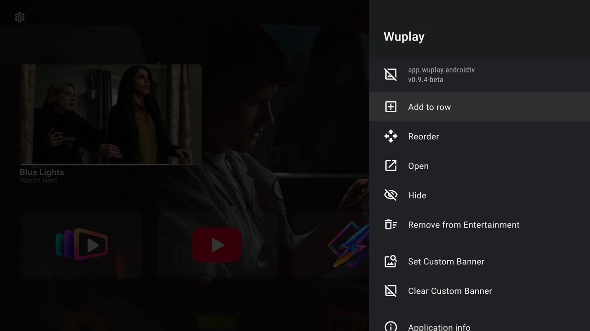
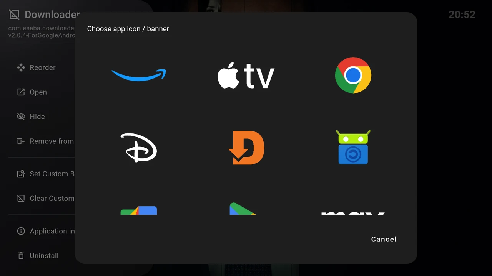

# Manage apps and artwork

On Home, focus an app and **hold Select** for about half a second to open its action menu. You can also open **Settings → Applications → Installed apps** to find an app, including a hidden one.

{ width="1280" height="720" loading="lazy" }

## Add an app to another row

Choose **Add to row**, then select the destination. The list includes rows that do not already contain the app, including hidden rows. If there are no choices, create a row or check whether the app already belongs to every row.

**Remove from {row name}** removes only the current membership. It leaves the app installed and available in its other rows.

## Move an app within a row

1. Make sure the row’s **App order** is **Manual** in [the row editor](rows.md#rename-and-sort).
2. On Home, hold Select on the app and choose **Reorder**.
3. Use **Left/Right** to move the card.
4. Press **Select** or **Back** to finish and save.

Up/Down does not move an app into another row. Use Add to row and Remove from the current row for that. **Reorder** is absent in Alphabetical and Last used rows because those modes determine positions automatically.

## Hide an app and bring it back

Choose **Hide** in the app menu or installed-app details. Hiding is global: the app disappears from all Home rows, while its memberships remain saved.

To restore it:

1. Open **Settings → Applications → Installed apps**.
2. Find the app marked **Hidden on home screen**.
3. Open it and select **Show**.

The app returns to its enabled rows. Add to row is available again once the app is shown.

## Choose custom artwork

1. Hold Select on the app and choose **Set Custom Banner**.
2. Browse the **Choose app icon / banner** grid with the D-pad. It contains bundled artwork and has no text labels under its images.
3. Press **Select** on an image to apply it immediately. **Cancel** or Back closes the picker without choosing.

{ width="1280" height="720" loading="lazy" }

The chosen image changes this app’s card throughout the launcher. The picker offers the artwork included in your build; it is not a file browser. It does not need access to your media files.

Choose **Clear Custom Banner** to restore the app’s normal artwork. This action appears only when an override exists. Apps without a suitable banner can use an icon and the app name inside the card. Optional [labels below cards](../personalise/appearance.md#labels-sound-and-focus-feedback) are a separate setting.

## Open Android app details or uninstall

**Open** launches the app. **Application info** opens Android’s own app-details page. **Uninstall** starts Android’s uninstall flow; follow its confirmation to remove the application from the TV.

Removing an app from a row, hiding it and uninstalling it have different effects:

| Action | Result |
| --- | --- |
| **Remove from a row** | Only that row loses the app. |
| **Hide** | All Home rows hide it; saved memberships remain. |
| **Uninstall** | Android removes the app from the device after its confirmation. |

Installed-app details show the app’s name and version. Use these when [reporting a problem](../help/troubleshooting.md#report-a-problem), especially when an external app does not open as expected.
