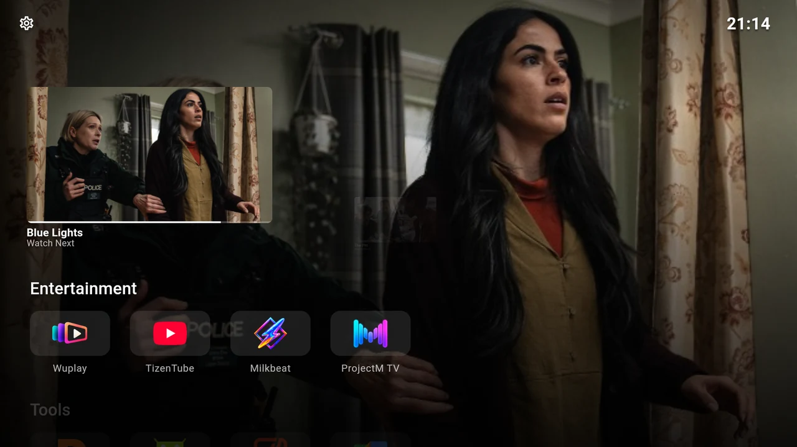
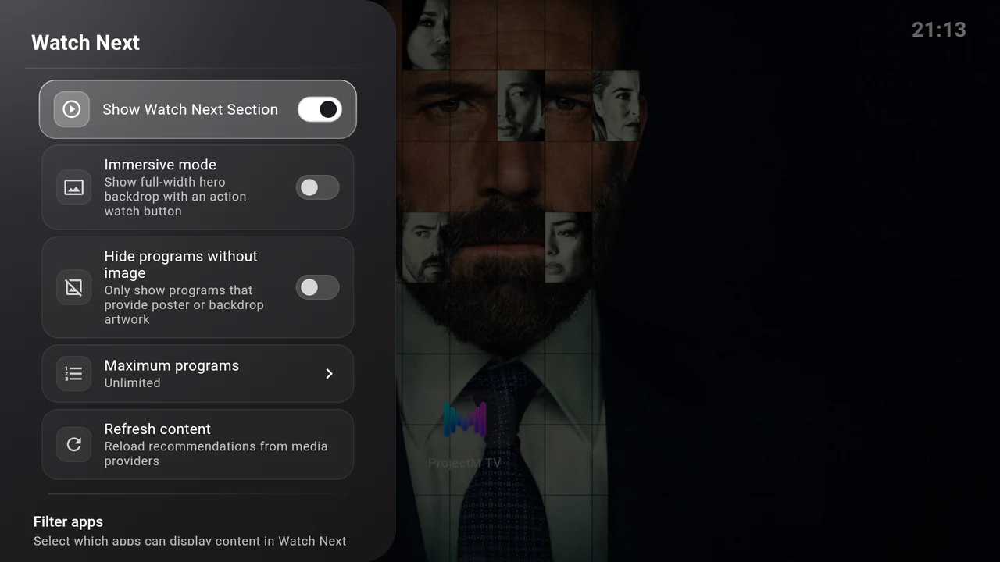

# Continue Watching

Continue Watching uses Android TV’s **Watch Next** feed. Compatible apps supply programme titles, artwork, progress and a link back into the app. Backdrop Launcher displays that information; the provider app handles playback and subscriptions.

{ width="1280" height="720" loading="lazy" }

The area is called **Watch Next** in Settings. It appears on Home only when enabled and eligible programmes are available. Installing an app or connecting Trakt does not automatically create a programme here.

## Turn it on

1. Open **Settings → Interface → Watch Next**.
2. Enable **Show Watch Next Section**.
3. If asked for TV-listings access, choose **Grant permission** and follow Android’s prompt. Return and select **Check again** if shown.
4. Choose **Refresh content** to reload the provider feed.

{ width="1280" height="720" loading="lazy" }

If the TV cannot provide a permission screen, see [Continue Watching is missing](../help/troubleshooting.md#continue-watching-is-missing).

## Browse and resume

From the first app row press **Up**, then use **Left/Right** to browse programmes. Press **Select** on the selected card to open it in its provider app. **Down** returns to your app rows; **Up** reaches the status bar.

In the compact layout, the smaller next-programme preview moves left and grows into the active card as you browse. The outgoing card slides offscreen at full size.

The progress strip reflects data supplied by the provider. A provider may open a detail page or loading screen before playback. It controls the exact resume behaviour.

## Choose how it looks

| Setting | Effect |
| --- | --- |
| **Immersive mode** | Use the selected programme’s artwork across Home. Turn it off to keep your regular backdrop. |
| **Hide programs without image** | Exclude programmes without suitable artwork. This can reduce the number shown. |
| **Maximum programs** | Choose **Unlimited**, **5**, **10**, **15**, **20**, **25**, **30** or **50**. Unlimited adds no lower user limit; the provider feed is still capped at 50 items. |
| **Refresh content** | Reload the feed and retry artwork. A completion message confirms the refresh, without promising new programmes. |

To change the height, card sizes, second card opacity or spacing, see [Arrange Continue Watching](../personalise/appearance.md#arrange-continue-watching).

Turn **Show Watch Next Section** off to hide the area. Its content is not polled or its posters loaded while disabled.

## Include only the apps you want

Scroll to **Filter apps** in the same settings page. A switch **on** allows that app’s content; **off** excludes it. The first view shows known content providers and remembered exclusions.

Choose **Show all installed apps** to expose the full installed-app filter list. Choose **Filter apps** again to return to the providers view. Allowing an app does not make it publish Watch Next content.

If every available programme is filtered out, the whole area disappears. Check both the app filter and **Hide programs without image** before assuming the feed is broken.

!!! tip "Use a compatible app first"
    Start a programme in the provider app and leave it partway through, then return to Home and refresh. Apps decide which items they publish, when they publish them and whether they offer resume links.
