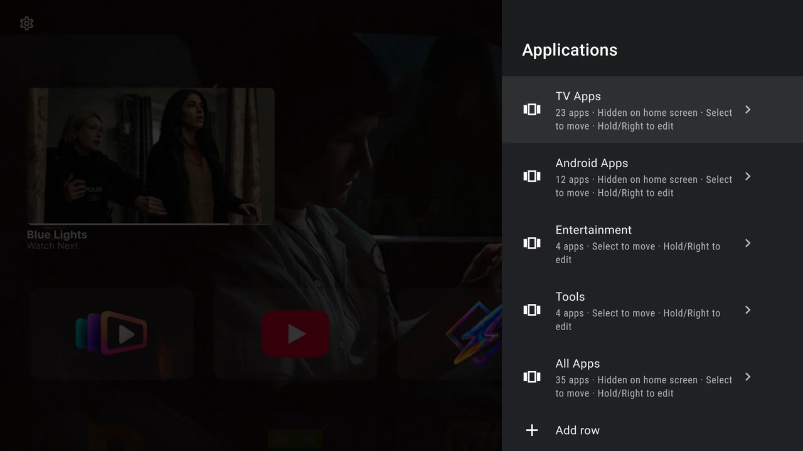
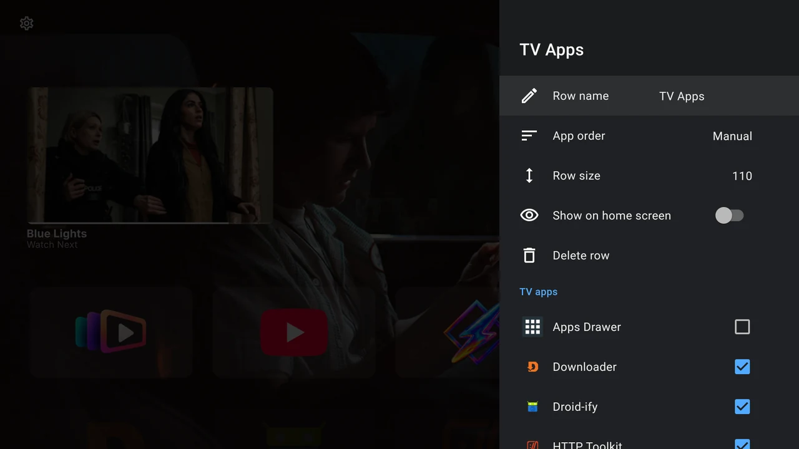

# Create and arrange app rows

Rows let you group apps around the way you use your TV. Open **Settings → Applications** to see every row, including hidden and empty ones.

{ width="1280" height="720" loading="lazy" }

## Create a row

1. Select **Add row**.
2. Enter a name with the on-screen keyboard. The name must contain some text.
3. Choose **Save**, or the keyboard’s Done action.
4. In the row editor, scroll to **TV apps** and **Android apps**. Check the apps you want to include.
5. Press Back to return to the row manager, then Back again to Home.

A new row starts with **Manual** app order and **Show on home screen** enabled. An empty row stays in Applications until you add an app. An app can be checked in several rows.

{ width="1280" height="720" loading="lazy" }

## Move a row

Focus the row in **Applications**, then press **Select** briefly. Use **Up/Down** to change its position and press **Select** to finish. Position changes save immediately.

To edit instead of move, press **Right** on the row or **hold Select** for about half a second.

## Rename and sort

Open the row editor with Right or hold Select.

| Control | How to use it |
| --- | --- |
| **Row name** | Select, edit the text, then Save. Cancel leaves the name unchanged. |
| **App order** | Select to cycle **Manual → Alphabetical → Last used**. Alphabetical sorts names; Last used puts the most recently launched app first. |
| **Show on home screen** | Turn off to hide the whole row while keeping its apps and saved order. |

Every row uses the same card size. Change it with **App size** in [App row layout](../personalise/appearance.md#arrange-your-app-rows).

To position individual cards by hand, choose **Manual**, return to Home and use [Reorder](apps.md#move-an-app-within-a-row).

## Change membership

In the editor, check an app to add it and uncheck it to remove it from this row. Other rows keep their membership. Alternatively, [hold Select on an app](apps.md#add-an-app-to-another-row) on Home and use **Add to row** or **Remove from {row name}**.

A globally hidden app may remain checked and show **Hidden on home screen**. It stays absent from all Home rows until you [show it again](apps.md#hide-an-app-and-bring-it-back).

## Show a TV channel as a row

Many apps publish channels for the Android TV home screen, such as recommendations or a list of new films. Backdrop can show those channels as rows next to your apps.

1. Open **Settings → Applications → TV channels**.
2. If **Grant TV listings permission** appears, select it and accept Android's prompt.
3. Check the channels you want. Each one is listed with the app that publishes it, and Home updates behind the settings panel.

A selected channel becomes a row at the bottom of Home. Move it, rename it or hide it in **Applications** like any other row. No channel is shown until you select it.

Select a program to open it in its app. Hold Select on a program to open the row's settings.

Channel rows use the same card height as your app rows. Posters are preferred over still images from the program, so a card is as wide as its artwork: a film poster is narrow and a wide image is wider. A still image is used when an app has no poster or its poster cannot be loaded, and a card without any artwork shows the title.

A channel with nothing to show stays out of Home, and it returns when the app publishes programs again. To stop showing a channel, uncheck it under **TV channels**, or select **Remove channel** in its row editor.

Live TV channels from a tuner are not listed. Apps decide what they publish, so an app that has no channels will not appear here.

## Delete a row

Select **Delete row** in its editor, then confirm. It removes the row and its memberships. The apps themselves stay installed, and their membership in other rows is preserved.

For a temporary change, use **Show on home screen** instead of deleting the row.
