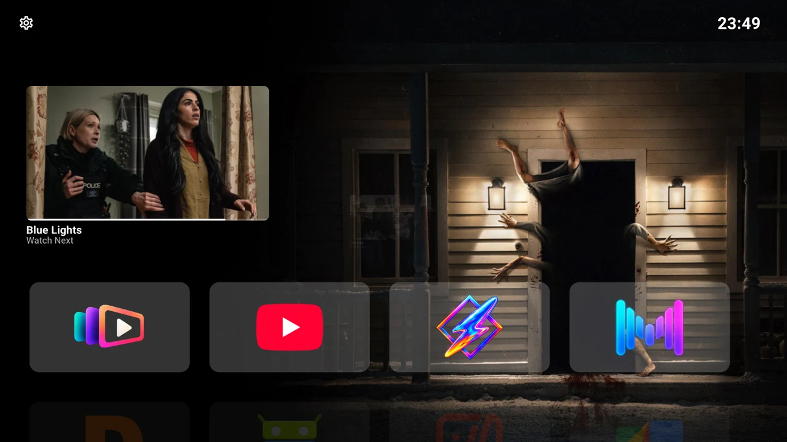

THE BACKDROP LAUNCHER USER GUIDE

# Your TV. Your way.

A cinematic home for Android TV. Give your apps a place, your artwork room to breathe, and your next episode a way back.

[Get started :material-arrow-right:](get-started/index.md){ .md-button .md-button--primary }
[Explore your home](home/index.md){ .md-button }

Open source · Made for the remote · Yours to arrange

{ width="1280" height="720" }

Your apps in the foreground. Cinema in the background.

## Make yourself at home

-   :material-remote-tv:{ .lg .middle } **Start with your remote**

    Install the app, find Settings and learn the few gestures that control everything.

    [Set up your TV](get-started/index.md)

-   :material-view-sequential:{ .lg .middle } **Your apps. Your rows.**

    Create rows for the way you watch, move apps into place and keep unwanted cards out of Home.

    [Arrange your apps](home/rows.md)

-   :material-play-circle-outline:{ .lg .middle } **Pick up where you left off**

    Browse Continue Watching from compatible TV apps and open a programme in its original app.

    [Use Continue Watching](home/continue-watching.md)

-   :material-image-multiple-outline:{ .lg .middle } **Give your screen a fresh scene**

    Enjoy the included cinematic backdrops or connect Trakt to choose catalogs and public lists.

    [Choose your backdrops](personalise/backdrops.md)

-   :material-palette-outline:{ .lg .middle } **Make it your colour**

    Choose an accent, adjust card backgrounds and decide how much information Home shows.

    [Personalise Home](personalise/appearance.md)

-   :material-clock-outline:{ .lg .middle } **A quieter screen between shows**

    Choose a clock style, set up Android’s screensaver and decide what Back does on Home.

    [Set up your clock](personalise/clock-and-back.md)

### A home screen, shaped around you

Backdrop Launcher opens your installed apps. Continue Watching depends on the apps that publish items to Android TV, and Trakt supplies backdrop discovery. Your streaming apps and subscriptions remain where you already use them.

[Find a setting](help/settings.md) · [Solve a problem](help/troubleshooting.md) · [Read the FAQ](help/faq.md)

