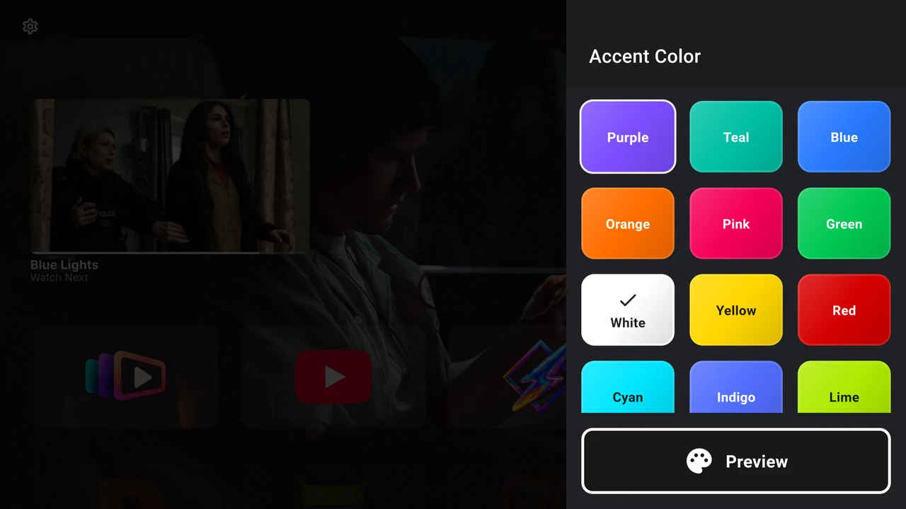
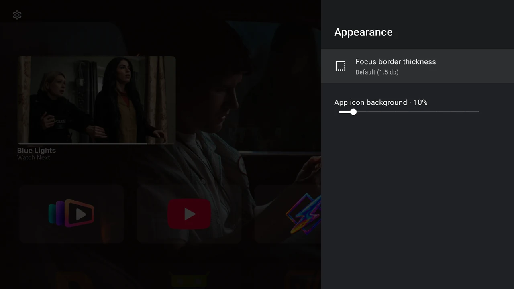

# Colours, cards and labels

The accent you choose belongs to your Home screen. Backdrop Launcher keeps that preference across restarts; the guide’s twilight violet is a separate website theme.

Settings uses native Android TV blue for its controls. Your Home accent remains visible in the colour and focus-border previews and in the app icon background slider.

## Choose your accent

Open **Settings → Interface → Accent Color**. Move through the grid and press **Select** to commit a colour. Focus alone does not change it. A check mark identifies the current selection and the **Preview** area shows it.

{ width="1280" height="720" loading="lazy" }

The palette contains **White, Grey, Black, Purple, Teal, Blue, Orange, Pink, Green, Yellow, Red, Cyan, Indigo, Lime, Amber, Rose** and **Ice Blue**. Your choice is used in focus outlines and app-card backgrounds. With **Black**, app cards turn black while the focus outline and Continue Watching progress stay white, so you can see them on dark backdrops.

## Make cards readable over artwork

Open **Settings → Interface → Appearance**.

{ width="1280" height="720" loading="lazy" }

**App icon background** adjusts the accent-coloured material behind app artwork. Focus the slider and use **Left/Right** in **10% steps**, from **0% to 100%**. The setting changes the background, not the opacity of the app image itself.

The default is 10%. More opaque card backgrounds can make cards easier to distinguish against a busy scene. Check your choice on Home against several backdrops.

Select **Focus border thickness** to choose **Subtle (1.0 dp)**, **Default (1.5 dp)**, **Medium (2.0 dp)** or **Bold (3.0 dp)**. A TV-icon preview helps you compare them. Default is 1.5 dp.

## Arrange your app rows

Open **Settings → Interface → App row layout**. Each control is a slider: focus it and use **Left/Right** to move it, or hold the button to keep going. Home stays undimmed behind the panel, so you can watch each change.

| Control | What changes |
| --- | --- |
| **Focused row height** | How far up the screen the active row sits. Every row stops on this line. While Continue Watching is showing, the highest setting is just below it. |
| **Row position** | How far from the left edge the row starts. |
| **App size** | The size of the app cards in every row. |
| **Space between apps** | The gap between cards in a row. |
| **Space between rows** | The distance from one row of cards to the next. |
| **Row below opacity** | How visible the rows under the active row are. At 0% they are hidden until you move down. |

A very large **App size** can push the row higher than the height you chose, so that it stays on screen. While Continue Watching is showing, rows stay below it and app cards stop growing once they fill the space that is left.

Select **Reset app row layout** to return to the defaults.

## Arrange Continue Watching

Open **Settings → Interface → Continue Watching layout**. It works the same way as the app row sliders, with Home visible behind the panel.

| Control | What changes |
| --- | --- |
| **Height** | How far up the screen the cards end. It uses the same scale as **Focused row height**, and it stops just above your app row. |
| **Card size** | The size of the selected card. The bottom edge stays where it is, so a smaller card keeps its distance from the app row. |
| **Second card size** | The size of the next card, compared with the selected card. |
| **Second card opacity** | How visible the next card is. |
| **Space between cards** | The distance between the two cards. |

Because **Height** and **Focused row height** stop at each other, lower your app row first, then bring Continue Watching down to meet it. **Height** and **Card size** also stop before the cards reach the top of the screen.

These controls apply to the compact layout. **Big picture mode** keeps its own layout.

Select **Reset Continue Watching layout** to return to the defaults.

## Labels, sound and focus feedback

Open **Settings → Interface → Miscellaneous**.

| Control | What changes |
| --- | --- |
| **App card highlight animation** | Pulse the focused card’s outline. Requires focus borders. |
| **Click sound on key press** | Play key-feedback sounds. TV volume and mute also affect what you hear. |
| **Show category titles** | Display row names on Home. |
| **Show App Names Below Icons** | Add app-name labels below the cards. |
| **Show focus borders** | Display the focused-card outline. |
| **Watch Next** | Open [Continue Watching settings](../home/continue-watching.md). |

Turning focus borders off also turns the highlight animation off. Turning borders on again does not re-enable the animation; enable it separately if you want it.

For clear remote navigation, keep focus borders visible and choose a thickness you can recognise from your usual seating distance. Row titles and app-name labels can help identify less familiar cards, though they use some of the space available to artwork.
