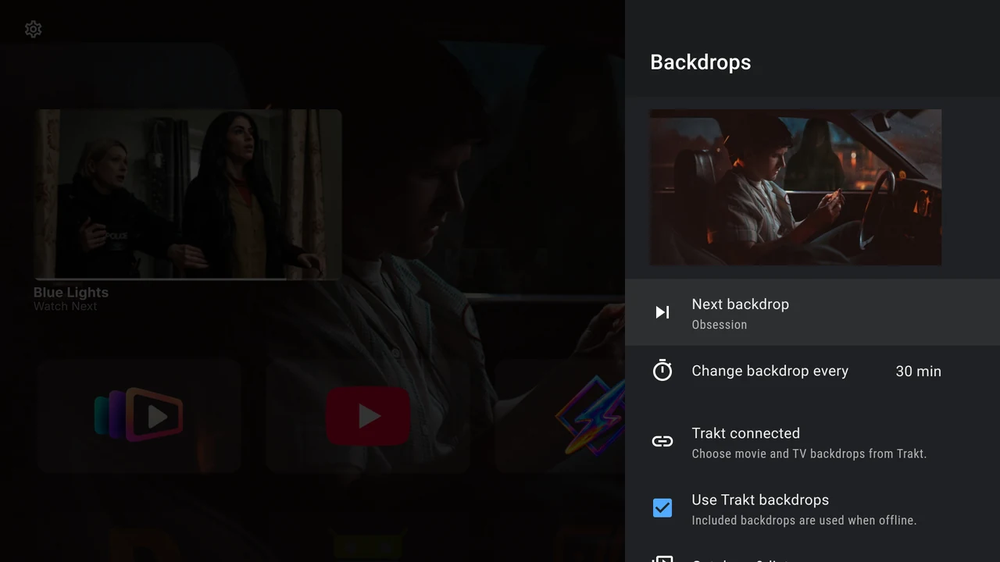
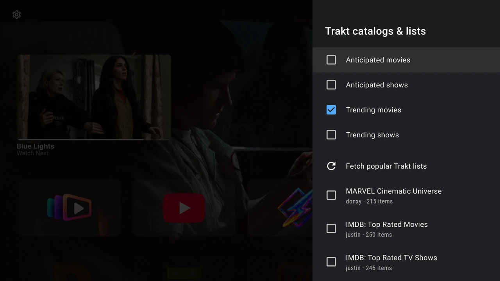

# Backdrops and Trakt

Open **Settings → Interface → Wallpaper**. The page is titled **Backdrops**. It shows your current artwork and the controls for choosing the next scene.

{ width="1280" height="720" loading="lazy" }

## Use the included backdrops

The app includes ten cinematic backdrops. Select **Next backdrop** to advance. No Trakt account is needed for these images.

Select **Change backdrop every** to cycle between **5**, **10**, **30** and **60 minutes**. The default is 10 minutes. Rotation runs while the launcher is active. Each start or return starts a fresh full interval and keeps the current image until that interval expires.

If Continue Watching’s [Immersive mode](../home/continue-watching.md#choose-how-it-looks) is on, its selected programme can cover the regular backdrop. Turn that mode off to see the backdrop you choose here.

## Connect Trakt

Trakt supplies movie and show catalogs and public lists for backdrop discovery. TMDB provides the artwork. This connection is for backdrops; it does not sync your viewing history or create Continue Watching programmes.

1. Select **Connect Trakt**.
2. Wait for the device-login screen to display a QR code, a verification address and a code.
3. On your phone or computer, scan the QR code or open the displayed address. Sign in to your Trakt account and enter the TV’s code if asked.
4. Approve the connection. Leave the TV’s dialog open while it waits.
5. When the page says **Trakt connected**, **Use Trakt backdrops** is enabled. Open **Catalogs & lists** to choose sources.

Use **Cancel** or Back on the TV to stop a pending login. If a code expires, start Connect Trakt again and use the new code. Each login supplies its own code; an example from a screenshot would not work.

If the page says **Trakt is not configured in this build**, that APK does not contain the service configuration. The included backdrops still work. Use a release that provides Trakt support, or follow the [developer build instructions](https://github.com/johnneerdael/Backdrop-Launcher/blob/main/docs/development/building.md) if you build the app yourself.

## Choose catalogs and public lists

Open **Catalogs & lists** and check the sources you want:

- **Anticipated movies**
- **Anticipated shows**
- **Trending movies**
- **Trending shows**

{ width="1280" height="720" loading="lazy" }

Choose **Fetch popular Trakt lists** to retrieve public lists, then check any you want to add. The available names, owners and item counts can change. Previously selected lists remain available even if they are absent from a later popular-lists result.

Selections save immediately. Keep at least one catalog or list selected, and choose sources containing movies or shows with available backdrop artwork. If nothing is selected, the page asks you to select a source.

Return to Backdrops and select **Next backdrop** to request another image. Not every title has usable artwork.

## Switch back to included artwork

Turn **Use Trakt backdrops** off. Your account stays connected and your source preferences remain available for later.

**Disconnect Trakt** disconnects immediately, without a confirmation. Use it when you want to remove the launcher’s connection, rather than temporarily use included artwork. Source and catalog controls are disabled while disconnected.

When Trakt backdrops are unavailable, the launcher falls back to included artwork. See [Backdrop or Trakt problems](../help/troubleshooting.md#backdrop-or-trakt-problems) for connection, code and source-selection messages.

This product uses the TMDB API but is not endorsed or certified by TMDB. Backdrop Launcher is independent of Trakt.

