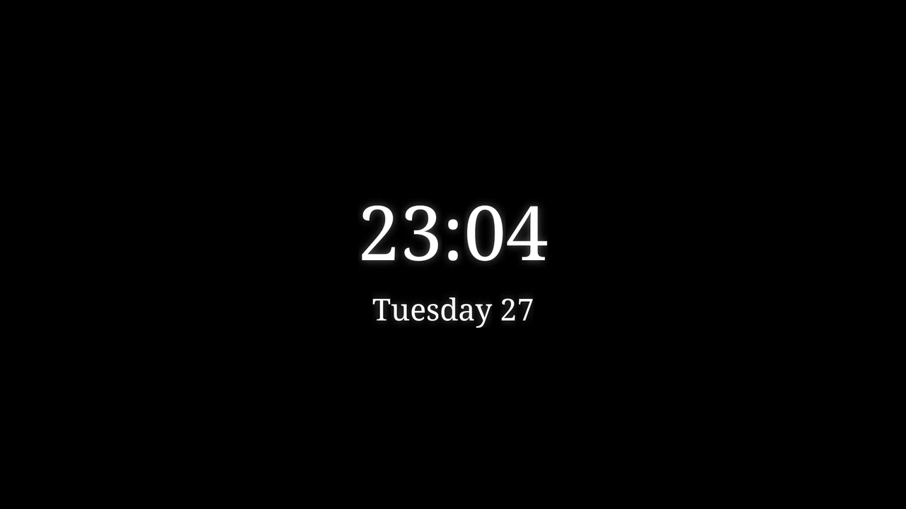

# Clock, screensaver and Back

Backdrop Launcher has a clock view on Home and a separate Android clock screensaver. You can choose a shared style, then decide which one you want to use.

{ width="1280" height="720" loading="lazy" }

## Choose a clock style

Open **Settings → System → Screensaver Clock Style**. Select **Minimal**, **Bold**, **Retro**, **Elegant**, **Neon**, **Pixel** or **Digital**. The check mark identifies the saved style. The picker describes each option; it does not show a live clock preview.

Date and time use the presets from [Date and time format](status-and-time.md#choose-a-date-or-time-format). Styles differ in typography and treatment, so try the actual clock or screensaver to see your choice at TV size.

## Set up Android’s screensaver

1. Open **Settings → System → Screensaver Settings**.
2. In Android’s screensaver menu, choose the **Backdrop Launcher Clock** provider.
3. Set Android’s **When to start** or equivalent option if available.
4. Use Android’s **Start now** or preview option to check it.

This opens your TV’s native settings. The menu can be under Display, Screen saver or another system section, and the exact labels vary. The launcher’s native clock screensaver uses its own black-background layout.

If Android’s screensaver does not start, see [Clock and screensaver problems](../help/troubleshooting.md#clock-and-screensaver-problems).

## Decide what Back does on Home

Open **Settings → System → Back button action** and select:

| Action | Result on Home |
| --- | --- |
| **Do nothing** | Keep Home visible. |
| **Show clock** | Switch to the launcher’s clock over its backdrop. Another Back returns to Home. |
| **Show screensaver** | Ask Android to start its configured screensaver, which may be another provider if you chose one. |

**Backdrop Launcher must be Android’s effective default Home app for this Home action to run in a release build.** If it is not, Back can exit to your TV’s original launcher. Choosing a radio option inside the app does not change Android’s Home-app selection.

Within Settings, Back returns to the parent page. In a card’s Reorder mode, Back finishes and saves the position before any Home Back action is considered.

## Which clock should I use?

Use **Show clock** for an immediate clock over your launcher backdrop when pressing Back. Use **Android’s screensaver** for the device-managed idle screen and its black background. The shared style does not make these two modes identical.
