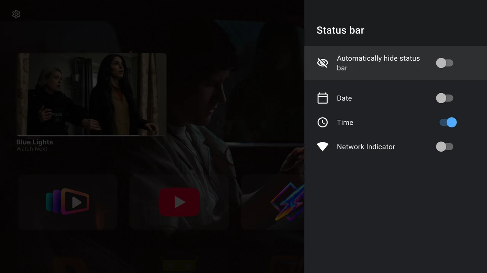
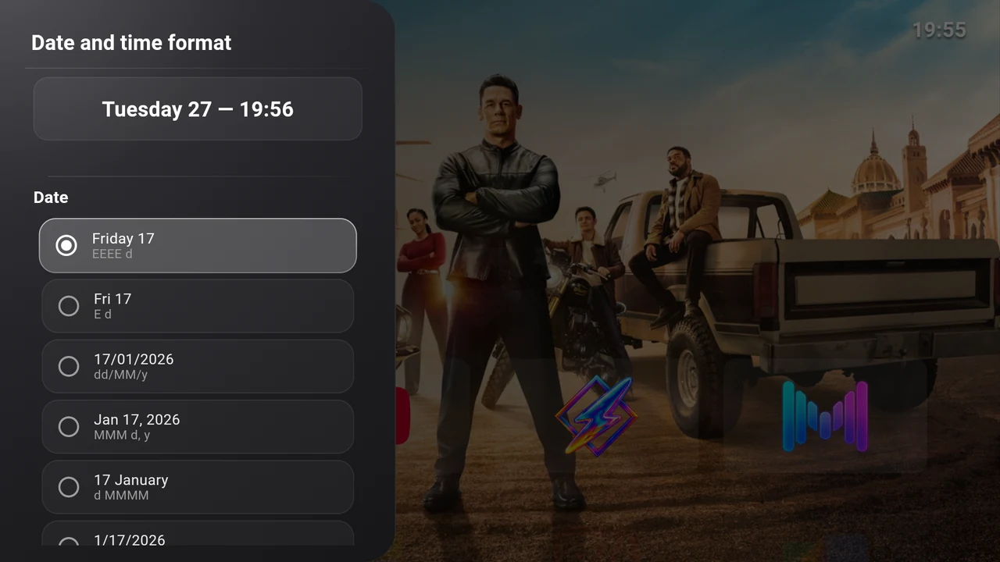

# Status bar and date formats

The status bar holds the Settings gear and optional date, time and network information. Open **Settings → Interface → Status bar** to choose what appears.

{ width="1280" height="720" loading="lazy" }

| Switch | What it does |
| --- | --- |
| **Automatically hide status bar** | Hide the bar when focus leaves it. Move focus Up to reveal it again. |
| **Date** | Show the device’s current date. |
| **Time** | Show the device’s current time. |
| **Network Indicator** | Show connection type or signal information supplied by Android. Select the indicator to open Android’s network settings. |

Date and Time are independent. Network status depends on your device and active connection; a switch cannot create a missing transport or connection.

## Choose a date or time format

Open **Settings → System → Date and time format**. Select a radio option in **Date format** and **Time format**. Each selection saves immediately. The preview uses the TV’s actual clock and locale; the examples beside options are fixed illustrations.

{ width="1280" height="720" loading="lazy" }

| Date example | Format |
| --- | --- |
| Friday 17 | Full weekday and day number |
| Fri 17 | Short weekday and day number |
| 17/01/2026 | Day/month/year |
| Jan 17, 2026 | Short month, day and year |
| 17 January | Day and full month |
| 1/17/2026 | Month/day/year |

| Time example | Format |
| --- | --- |
| 3:45 | 24-hour time without a leading zero (`H:mm`) |
| 03:45 | 12-hour time with a leading zero and no AM/PM (`hh:mm`) |
| 3:45 PM | 12-hour time with AM/PM (`h:mm a`) |
| 03:45 PM | 12-hour time with a leading zero and AM/PM (`hh:mm a`) |
| 15:45 | 24-hour time with a leading zero (`HH:mm`) |

These presets also apply to the [launcher clock and screensaver](clock-and-back.md). There is no custom-format text field.

## Correct the time itself

The format controls change presentation. If the clock or time zone is wrong, open **Settings → System settings** and adjust Android’s date and time settings. Their location and available automatic-time options vary by firmware.
